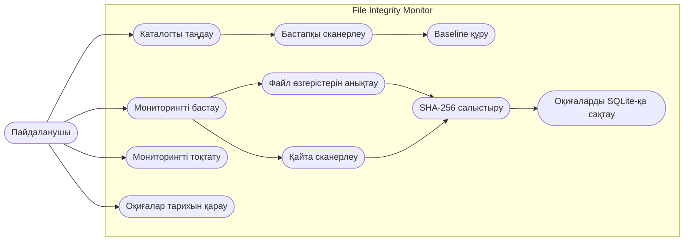
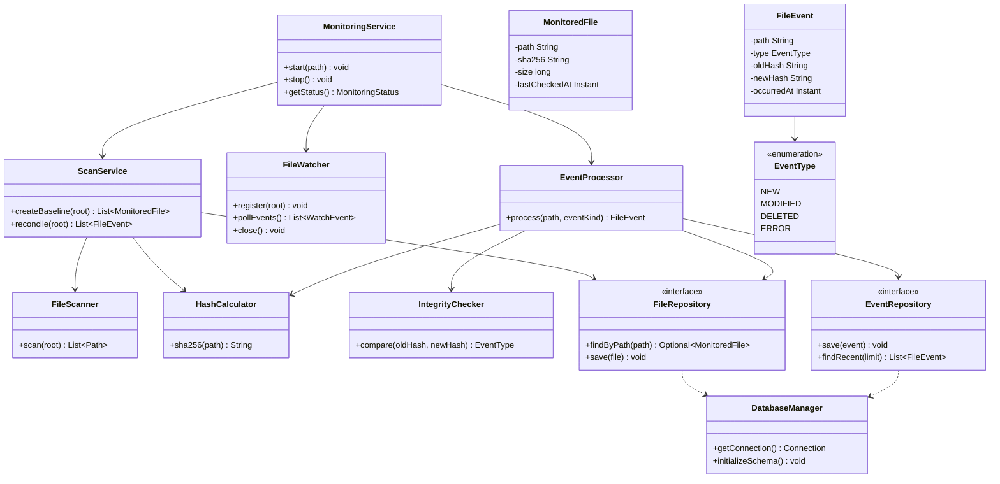
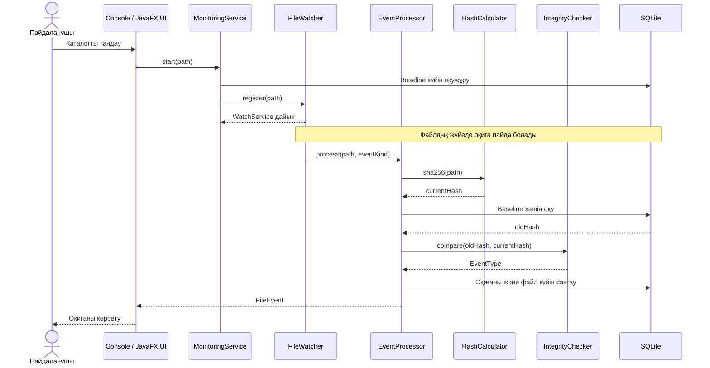
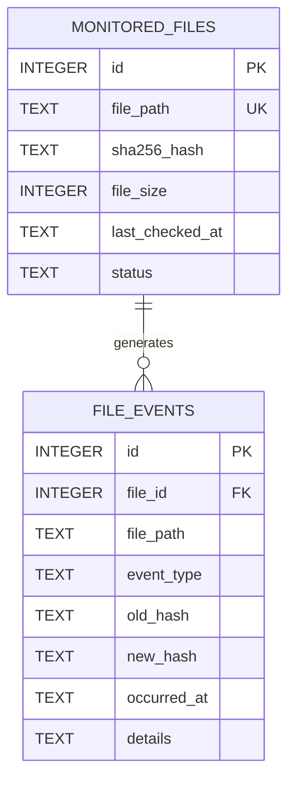

# File Integrity Monitor (FIM)

Java негізінде файлдар мен каталогтардың тұтастығын бақылауға арналған оқу-жобалық жүйе.

**Жоба кезеңі:** зерттеу және жобалау  
**Негізгі технологиялар:** Java 17+, Maven, Java NIO, SHA-256, SQLite  
**Интерфейстер:** Console және JavaFX Desktop (жоспарланған)

## 1. Жоба мақсаты

File Integrity Monitor (FIM) — пайдаланушы таңдаған каталогтағы файлдардың қосылуын, өзгертілуін және жойылуын анықтайтын бағдарлама. Жүйе файл мазмұнының SHA-256 хэшін есептеп, оны сенімді бастапқы күймен (baseline) салыстырады. Анықталған өзгерістер SQLite дерекқорында оқиға ретінде сақталады.

Бұл жоба оқу және демонстрациялық мақсатта әзірленеді. Ол Wazuh немесе OSSEC сияқты кәсіптік қауіпсіздік платформаларын алмастырмайды.

## 2. Негізгі міндеттер

- FIM жүйелерінің жұмыс принциптерін және қолданыстағы шешімдерді зерттеу.
- Бақыланатын каталог үшін бастапқы файлдар тізімін құру.
- Файлдық жүйе оқиғаларын Java NIO WatchService арқылы қабылдау.
- SHA-256 арқылы файл мазмұнының өзгергенін анықтау.
- NEW, MODIFIED, DELETED оқиғаларын тіркеу.
- Файлдардың бастапқы күйі мен оқиғалар тарихын SQLite-та сақтау.
- Ортақ Core логикасын Console және JavaFX интерфейстерінен пайдалану.
- JUnit 5 арқылы тестілеу және GitHub Actions арқылы автоматты тексеру.

## 3. Жоспарланған функциялар

- [ ] Бақыланатын каталогты таңдау
- [ ] Бастапқы сканерлеу және baseline құру
- [ ] WatchService арқылы оқиғаларды бақылау
- [ ] NEW / MODIFIED / DELETED оқиғаларын анықтау
- [ ] SHA-256 хэшін есептеу және салыстыру
- [ ] SQLite дерекқорына сақтау
- [ ] Оқиғалар тарихын қарау
- [ ] Консольдік интерфейс
- [ ] JavaFX графикалық интерфейсі
- [ ] JUnit 5 тестілері
- [ ] GitHub Actions CI workflow

> Бұл — жоспарланған функциялар. Тек іске асырылып, тексерілген мүмкіндіктер ғана орындалды деп белгіленеді.

## 4. Технологиялық стек

| Технология | Қолданылуы |
|---|---|
| Java 17+ | Негізгі бағдарламалау тілі |
| Maven | Жобаны құрастыру және тәуелділіктер |
| Java NIO WatchService | Файлдық жүйе оқиғаларын қабылдау |
| MessageDigest / SHA-256 | Файл хэшін есептеу |
| SQLite + JDBC | Жергілікті деректерді сақтау |
| JavaFX | Desktop интерфейсі |
| JUnit 5 | Автоматты тестілеу |
| Git және GitHub | Нұсқаларды басқару |
| GitHub Actions | CI құрастыруы мен тесттері |

## 5. Архитектура

Жүйе бірнеше қабаттан тұрады:

1. **Presentation** — Console және JavaFX интерфейстері.
2. **Application** — мониторингті басқару және оқиғаларды өңдеу сценарийлері.
3. **Core** — бастапқы сканерлеу, файлды бақылау, хэштеу және тұтастықты тексеру.
4. **Persistence** — SQLite дерекқоры және репозиторийлер.

Екі интерфейс те бірдей Application және Core модульдерін пайдаланады. Осылайша бизнес-логика қайталанбайды.

## 6. UML диаграммалары

Төмендегі UML диаграммалары README ішінде Mermaid форматында көрсетілген. Өңдеуге арналған PlantUML бастапқы файлдары [docs/uml](docs/uml/) каталогында сақталады.

### 6.1 Use Case Diagram



### 6.2 Class Diagram



### 6.3 Sequence Diagram — файл өзгерген кездегі процесс



### 6.4 Database ER Diagram



> Диаграммалар — жобаның жоспарланған архитектурасын көрсетеді. Нақты Java кластары мен дерекқор схемасы іске асыру барысында осы модельмен сәйкестендіріліп, қажет болса жаңартылады.

## 7. Жұмыс принципі

1. Пайдаланушы бақыланатын каталогты таңдайды.
2. Жүйе каталогты сканерлеп, қолжетімді файлдардың SHA-256 хэштерін есептейді.
3. Алынған бастапқы күй (baseline) дерекқорға жазылады.
4. WatchService файлдық жүйе оқиғаларын қабылдайды.
5. Оқиға өңдеуші файлдың ағымдағы күйін қайта тексереді.
6. Хэш baseline-пен салыстырылады.
7. Өзгеріс анықталса, оқиға дерекқорға жазылып, интерфейсте көрсетіледі.

**Маңызды техникалық шектеу:** WatchService оқиғалары операциялық жүйе мен файлдық жүйеге тәуелді. Оқиғалар біріктірілуі немесе жоғалуы мүмкін; OVERFLOW оқиғасы келгенде каталогтың күйін қайта тексеру қажет. Сондықтан жоба оқиғаға негізделген бақылаумен қатар мерзімді қайта сканерлеуді қарастырады.

## 8. Жоба құрылымы

```text
File-Integrity-Monitor-FIM-/
├── docs/
│   ├── RESEARCH.md
│   ├── ARCHITECTURE.md
│   └── uml/
│       ├── use-case.puml
│       ├── class-diagram.puml
│       ├── sequence-monitoring.puml
│       └── database-erd.puml
├── src/
│   ├── main/java/
│   └── test/java/
├── .github/workflows/
├── .gitignore
├── LICENSE
├── README.md
└── pom.xml
```

Бұл — жоспарланған құрылым; код модульдері әзірленген сайын қосылады.

## 9. Қауіпсіздік және шектеулер

- SHA-256 хэштеу — тұтастықты салыстыру әдісі; ол шифрлау немесе цифрлық қолтаңба емес.
- Baseline пен дерекқор қорғалмаса, оларды файлдармен бірге өзгертуге болады. Сондықтан өндірістік жүйеде бастапқы хэштерді бөлек қорғау, қолжетімділікті шектеу және аудит қажет.
- Жүйе тек оқуға рұқсаты бар файлдарды тексере алады.
- Үлкен файлдар, уақытша файлдар, символдық сілтемелер, файлдың хэш есептеу кезінде өзгеруі және қайталанатын оқиғалар арнайы өңдеуді қажет етеді.
- Файлдың өзгеруі автоматты түрде зиянды әрекет дегенді білдірмейді; оқиға тек зерттеуді қажет ететін өзгерісті көрсетеді.

## 10. Әзірлеу күйі

Қазіргі кезең — зерттеу, талаптарды анықтау және архитектураны жобалау. Нақты іске асырылу күйі осы README бөліміндегі тапсырмалар арқылы жаңартылады.

## 11. Құжаттама

- [Зерттеу жұмысы](docs/RESEARCH.md)
- [Жүйе архитектурасы](docs/ARCHITECTURE.md)
- [PlantUML бастапқы диаграммалары](docs/uml/)

## 12. Лицензия

Жоба репозиторийдегі [LICENSE](LICENSE) файлына сәйкес таратылады.
